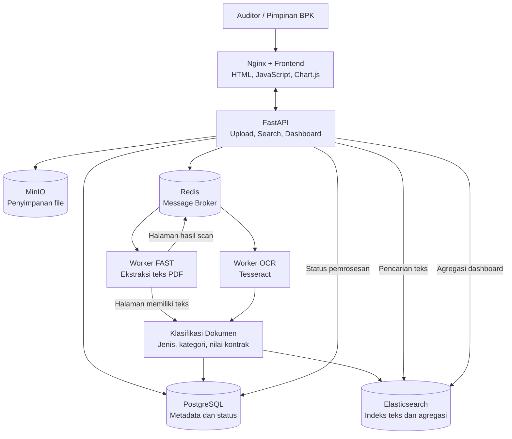

# Sistem Pencarian Dokumen Audit BPK

Implementasi studi kasus pencarian dokumen audit Badan Pemeriksa Keuangan (BPK) dengan dukungan OCR, pencarian teks penuh, dan dashboard analitik berdasarkan lembaga.

## 1. Gambaran Umum

Sistem ini dikembangkan untuk membantu auditor menemukan informasi dari dokumen audit dalam jumlah besar, baik PDF yang memiliki teks asli maupun dokumen hasil pemindaian. Pencarian dilakukan berdasarkan isi dokumen sehingga pengguna tidak terbatas pada judul atau metadata.

Beberapa kebutuhan utama yang ditangani sistem ini meliputi:

- **Pencarian isi dokumen:** Seluruh teks dokumen diproses dan dimasukkan ke Elasticsearch agar dapat dicari menggunakan kata kunci.
- **Pencarian yang toleran terhadap variasi kata:** Stemming bahasa Indonesia membantu menangani kata berimbuhan, sedangkan fuzzy search mengakomodasi kesalahan pengetikan.
- **Pemrosesan dokumen hasil scan:** Tesseract OCR digunakan untuk mengambil teks dari halaman yang belum memiliki teks digital.
- **Dashboard per lembaga:** Menampilkan jumlah dokumen, nilai kontrak, serta distribusi dan tren kategori belanja.
- **Unggah tanpa menunggu OCR:** Pemrosesan berat dijalankan di background melalui worker sehingga API dapat segera memberikan respons kepada pengguna.
- **Pembaruan data otomatis:** Hasil dashboard diperbarui secara berkala setelah dokumen selesai diproses dan diindeks.

## 2. Arsitektur Sistem

Arsitektur dibagi menjadi tiga alur utama, yaitu penerimaan dokumen, pemrosesan asinkron, serta pencarian dan penyajian data.

### Diagram aliran data



### Alur 1 — Penerimaan dokumen

1. Pengguna mengunggah dokumen melalui frontend.
2. Nginx meneruskan permintaan ke FastAPI melalui endpoint `POST /api/documents`.
3. API menyimpan berkas asli di MinIO dan mencatat informasi dokumen beserta status pemrosesannya di PostgreSQL.
4. Tugas pemrosesan dikirim ke Redis untuk dikerjakan oleh worker.
5. API mengembalikan respons `202 Accepted` tanpa menunggu proses OCR dan pengindeksan selesai.

Pemisahan ini memungkinkan pengguna mengunggah dokumen tanpa harus menunggu seluruh proses ekstraksi teks selesai.

### Alur 2 — Pemrosesan di background

1. Worker FAST mengambil tugas dari antrean dan membaca file dari MinIO.
2. PyMuPDF digunakan untuk mengekstrak teks yang sudah tersedia pada PDF.
3. Apabila ditemukan halaman yang tidak memiliki cukup teks, halaman tersebut diteruskan ke antrean OCR.
4. Worker OCR menjalankan Tesseract dengan dukungan bahasa Indonesia dan Inggris untuk memperoleh teks dari halaman hasil scan.
5. Hasil ekstraksi diteruskan ke proses klasifikasi untuk memperkirakan jenis dokumen, kategori belanja, dan nilai kontrak.
6. Teks beserta informasi terkait dimasukkan ke Elasticsearch.
7. Status dokumen diperbarui di PostgreSQL setelah pemrosesan berhasil.

Pemeriksaan dilakukan pada tingkat halaman agar PDF yang mengandung teks digital sekaligus halaman hasil scan tetap dapat diproses secara efisien.

### Alur 3 — Pencarian dan dashboard

1. Pengguna memasukkan kata kunci melalui halaman pencarian.
2. FastAPI meneruskan permintaan pencarian ke Elasticsearch.
3. Elasticsearch mencocokkan kata kunci dengan isi dokumen menggunakan stemming, fuzzy matching, dan pencarian frasa.
4. Hasil pencarian dikembalikan dengan informasi dokumen dan penyorotan teks yang cocok.
5. Untuk dashboard, Elasticsearch menghitung jumlah dokumen, nilai kontrak, serta tren kategori belanja melalui agregasi.
6. FastAPI menggabungkan hasil analitik dengan status antrean dari PostgreSQL.
7. Frontend melakukan polling setiap lima detik agar tampilan mengikuti perkembangan pemrosesan dokumen.

## 3. Teknologi dan Komponen

| Komponen | Teknologi | Tanggung jawab |
|---|---|---|
| Frontend | HTML, JavaScript, Chart.js | Antarmuka unggah, pencarian, dan dashboard |
| Reverse proxy | Nginx | Menyajikan frontend dan meneruskan request API |
| API | FastAPI | Menangani unggah, pencarian, dashboard, dan unduhan |
| Worker FAST | Celery, PyMuPDF | Ekstraksi teks dari PDF digital |
| Worker OCR | Celery, Tesseract | Ekstraksi teks dari halaman hasil scan |
| Message broker | Redis 7 | Menyimpan dan mendistribusikan tugas pemrosesan |
| Database | PostgreSQL 16 | Menyimpan metadata serta status dokumen |
| Object storage | MinIO | Menyimpan file dokumen asli |
| Search engine | Elasticsearch 8.17 | Pencarian teks, fuzzy matching, highlight, dan agregasi |

Seluruh komponen dijalankan menggunakan Docker Compose. Worker FAST dan worker OCR dipisahkan agar kapasitas pemrosesan dokumen biasa tidak terlalu terpengaruh oleh pekerjaan OCR yang lebih berat.

## 4. Alasan Pemilihan Arsitektur

### Pemisahan antrean FAST dan OCR

Ekstraksi teks PDF digital umumnya lebih ringan dibandingkan OCR. Oleh karena itu, kedua jenis pekerjaan ditempatkan pada antrean yang berbeda.

Pemisahan tersebut memungkinkan worker FAST tetap memproses dokumen digital ketika antrean OCR sedang padat. Jumlah worker OCR juga dapat ditambah sesuai kebutuhan.

Contoh penambahan worker OCR:

```bash
docker compose up -d --scale worker-ocr=3
```

### Penggunaan Elasticsearch

PostgreSQL digunakan untuk data terstruktur, sedangkan Elasticsearch menangani pencarian isi dokumen dan agregasi analitik. Pemisahan ini memungkinkan pencarian teks dilakukan tanpa membebani query metadata secara berlebihan.

Konfigurasi pencarian memanfaatkan analyzer bahasa Indonesia, field teks tanpa stemming, fuzzy matching, pencarian frasa, dan highlight untuk meningkatkan relevansi hasil.

### Ketahanan pemrosesan

Pipeline dirancang agar tugas dapat dicoba kembali ketika terjadi kegagalan. Konfigurasi Celery mencakup mekanisme pengakuan tugas setelah eksekusi dan penolakan ulang tugas apabila worker terhenti dalam kondisi tertentu.

ID dokumen digunakan sebagai identitas dokumen di Elasticsearch sehingga pengindeksan ulang dapat dilakukan tanpa membuat dokumen duplikat. Redis juga dikonfigurasi menggunakan AOF untuk membantu mempertahankan data antrean saat terjadi restart.

Apabila pemrosesan tetap gagal setelah percobaan ulang, status dokumen dapat ditandai `failed` beserta informasi kesalahannya.

## 5. Struktur Direktori

Struktur utama proyek adalah sebagai berikut:

```text
bpk-audit-search/
├── docker-compose.yml
├── README.md
├── docs/
│   ├── architecture.svg
│   └── architecture.png
├── db/
│   └── init.sql
├── nginx/
│   └── default.conf
├── frontend/
│   ├── index.html
│   ├── app.js
│   ├── style.css
│   └── vendor/
│       └── chart.umd.js
└── backend/
    ├── Dockerfile
    ├── requirements.txt
    └── app/
        ├── main.py
        ├── tasks.py
        ├── extract.py
        ├── classify.py
        ├── search.py
        ├── storage.py
        ├── db.py
        └── seed.py
```

Fungsi beberapa file penting:

- `main.py`: definisi endpoint dan logika API.
- `tasks.py`: pengaturan tugas Celery dan alur pemrosesan dokumen.
- `extract.py`: ekstraksi teks PDF serta pemrosesan OCR.
- `classify.py`: identifikasi jenis dokumen, kategori belanja, dan nilai kontrak.
- `search.py`: konfigurasi indeks, query pencarian, dan agregasi Elasticsearch.
- `storage.py`: operasi penyimpanan dokumen di MinIO.
- `db.py`: koneksi dan operasi database PostgreSQL.
- `seed.py`: pembuatan data contoh untuk pengujian.

## 6. Instalasi dan Menjalankan Aplikasi

### Prasyarat

- Docker dengan Docker Compose v2.
- Memori kosong sekitar 3 GB atau lebih.
- Koneksi internet pada saat pertama kali mengunduh image dan membangun container.

Pada Linux dengan Docker native, Elasticsearch mungkin memerlukan konfigurasi kernel berikut:

```bash
sudo sysctl -w vm.max_map_count=262144
```

### Langkah menjalankan

Masuk ke direktori proyek, lalu bangun dan jalankan seluruh layanan:

```bash
docker compose up -d --build
```

Periksa status container:

```bash
docker compose ps
```

Tunggu hingga Elasticsearch dan layanan pendukung siap sebelum melakukan pengujian.

Untuk membuat 40 dokumen contoh, termasuk sebagian dokumen hasil scan:

```bash
docker compose exec api python -m app.seed --count 40
```

### Alamat layanan

| Layanan | Alamat |
|---|---|
| Aplikasi | http://localhost:8080 |
| Dokumentasi API | http://localhost:8000/docs |
| Konsol MinIO | http://localhost:9001 |
| Elasticsearch | http://localhost:9200 |

Kredensial MinIO untuk lingkungan pengembangan menggunakan konfigurasi bawaan `minioadmin / minioadmin`, jika belum diubah melalui konfigurasi proyek.

### Memantau dan menghentikan layanan

Melihat log worker:

```bash
docker compose logs -f worker-fast worker-ocr
```

Menghentikan container tanpa menghapus volume data:

```bash
docker compose down
```

Menghentikan layanan sekaligus menghapus volume data:

```bash
docker compose down -v
```

Perintah terakhir menghapus data persisten proyek, sehingga gunakan hanya ketika data memang tidak lagi dibutuhkan.

## 7. Pengujian Fungsional

### A. Pengujian pencarian

Gunakan beberapa kata kunci berikut untuk memeriksa kemampuan pencarian:

| Kata kunci | Tujuan pengujian |
|---|---|
| `bahan bakar` | Menemukan informasi dalam isi dokumen |
| `jasa konsultasi` | Menguji relevansi kata berimbuhan |
| `blanja modaal` | Menguji toleransi terhadap salah ketik |
| `pengadaan gedung` | Menguji pencarian frasa |

Dokumen hasil OCR seharusnya dapat ditemukan setelah proses ekstraksi teks dan pengindeksan selesai.

### B. Pengujian dashboard

Buka tab dashboard dan pilih lembaga yang ingin dianalisis. Informasi yang ditampilkan meliputi jumlah dokumen, jumlah dokumen yang sudah terindeks, nilai kontrak, status antrean, serta distribusi dan tren kategori belanja.

Jalankan seeder kembali atau unggah dokumen baru. Setelah dokumen selesai diindeks, perubahan agregasi akan terlihat melalui polling berkala pada frontend.

### C. Pengujian unggah dan antrean

Unggah PDF digital dan PDF hasil scan melalui halaman unggah. Amati waktu respons API serta perubahan status dokumen, mulai dari antrean hingga selesai diproses.

Pengujian ini bertujuan memastikan bahwa respons unggah tidak perlu menunggu pekerjaan OCR selesai.

### D. Pengujian melalui cURL

Mengunggah dokumen:

```bash
curl -s -w '\nwaktu: %{time_total}s\n' \
  -X POST http://localhost:8000/api/documents \
  -F "files=@dokumen.pdf" \
  -F "institution=Kementerian Kesehatan" \
  -F "doc_date=2026-10-01"
```

Menguji pencarian:

```bash
curl -s "http://localhost:8000/api/search?q=blanja%20modaal"
```

Menguji dashboard:

```bash
curl -s "http://localhost:8000/api/dashboard?institution=Kementerian%20Kesehatan"
```

Pastikan file `dokumen.pdf` tersedia pada direktori kerja ketika menjalankan perintah unggah.

## 8. Ringkasan Endpoint API

| Method | Endpoint | Kegunaan |
|---|---|---|
| POST | `/api/documents` | Mengunggah satu atau beberapa dokumen |
| GET | `/api/documents?institution=&limit=` | Menampilkan dokumen terbaru dan status pemrosesan |
| GET | `/api/documents/{id}/download` | Mengunduh atau menampilkan file asli |
| GET | `/api/search?q=&institution=&category=&doc_type=&page=&size=` | Mencari dokumen berdasarkan isi dan filter |
| GET | `/api/dashboard?institution=&interval=day\|week\|month` | Mengambil statistik dan agregasi dashboard |
| GET | `/api/institutions` | Mendapatkan daftar lembaga |

Endpoint unggah menggunakan respons `202 Accepted` untuk menunjukkan bahwa permintaan telah diterima dan pemrosesan dilanjutkan secara asinkron.

## 9. Detail Implementasi

### Pencarian teks

Elasticsearch menggunakan analyzer `id_text` yang mencakup normalisasi huruf, penghilangan stopword bahasa Indonesia, dan stemming. Tersedia pula subfield `content.plain` yang tidak menggunakan stemming.

Query pencarian menggabungkan pencocokan teks ber-stemming, fuzzy matching, pencarian frasa dengan bobot tambahan, serta pencocokan nama file. Kombinasi ini membantu meningkatkan peluang menemukan dokumen ketika pengguna memakai bentuk kata yang berbeda atau salah mengetik.

### Deteksi halaman yang membutuhkan OCR

Halaman dengan teks kurang dari ambang `MIN_CHARS_PER_PAGE` dianggap berpotensi sebagai hasil scan. Nilai bawaan yang digunakan adalah 40 karakter.

Pada dokumen campuran, OCR dapat difokuskan pada halaman yang membutuhkan ekstraksi tambahan sehingga halaman dengan teks digital tidak perlu diproses ulang menggunakan OCR.

### Klasifikasi dokumen

Klasifikasi menggunakan aturan berbasis teks untuk memperkirakan jenis dokumen, kategori belanja, dan nilai kontrak. Nilai kontrak dicari berdasarkan pola angka dan petunjuk seperti “nilai kontrak” atau “sebesar”, dengan pendekatan cadangan jika pola utama tidak ditemukan.

Metode ini dibuat sederhana agar mudah dipahami dan diuji. Untuk penerapan produksi, klasifikasi dapat dikembangkan menggunakan model machine learning atau named entity recognition.

### Pembaruan dashboard

Dashboard mengambil agregasi langsung dari indeks Elasticsearch, bukan mengandalkan proses rekap manual yang harus dijalankan terpisah. Setelah dokumen selesai diindeks, dokumen tersebut dapat ikut dihitung dalam agregasi berikutnya.

Frontend menggunakan polling lima detik. Pendekatan ini cukup sederhana untuk kebutuhan studi kasus, meskipun WebSocket atau Server-Sent Events dapat dipertimbangkan apabila diperlukan pembaruan berbasis event.

## 10. Konfigurasi Penting

| Variabel | Nilai bawaan | Keterangan |
|---|---|---|
| `MAX_UPLOAD_MB` | 50 | Batas ukuran unggahan per file |
| `MIN_CHARS_PER_PAGE` | 40 | Ambang teks untuk mendeteksi halaman yang membutuhkan OCR |
| `OCR_DPI` | 200 | Resolusi render halaman sebelum OCR |
| `OCR_LANG` | `ind+eng` | Bahasa yang digunakan oleh Tesseract |
| `MAX_INDEX_CHARS` | 1500000 | Batas karakter dokumen yang dimasukkan ke indeks |

Konfigurasi lingkungan diatur melalui `docker-compose.yml` dan `backend/app/config.py`. Kapasitas worker dapat disesuaikan melalui pengaturan concurrency atau jumlah replika container.

## Kesimpulan

Sistem pencarian dokumen audit BPK ini menggabungkan penyimpanan dokumen, pemrosesan asinkron, OCR, pencarian teks penuh, dan analitik dalam satu arsitektur berbasis container. Pemisahan API dari worker memungkinkan unggahan tetap responsif, sementara Elasticsearch mendukung pencarian isi dokumen dan perhitungan statistik untuk dashboard lembaga.

Implementasi ini merupakan prototipe studi kasus yang ditujukan untuk mendemonstrasikan integrasi antarkomponen, pengolahan dokumen digital maupun hasil scan, serta pengelolaan aliran data menggunakan Docker Compose.
